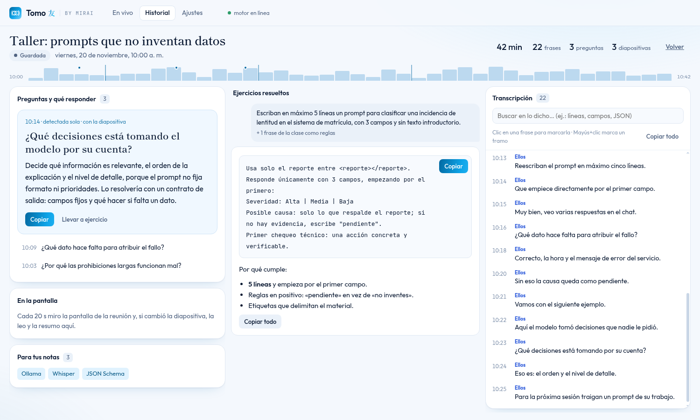
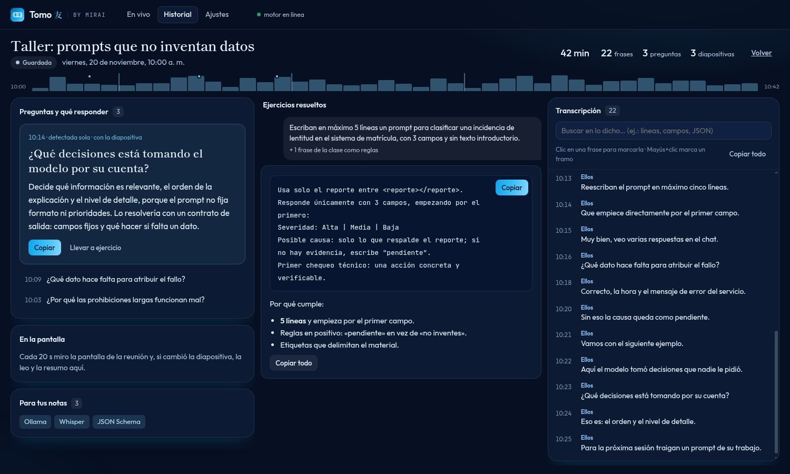
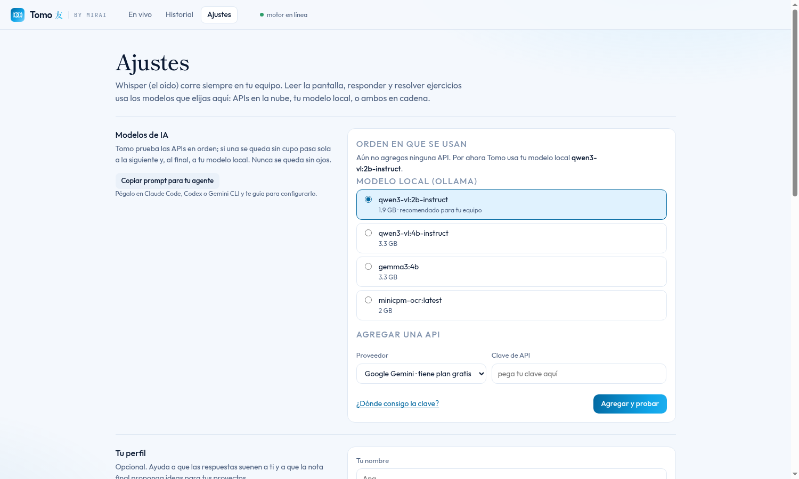
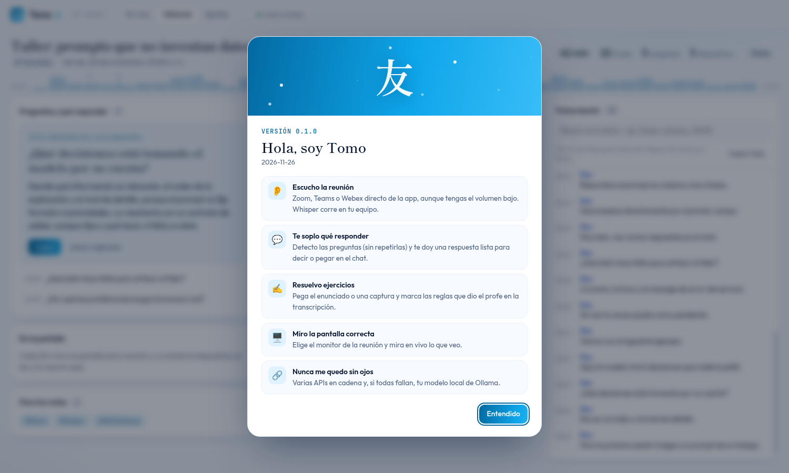
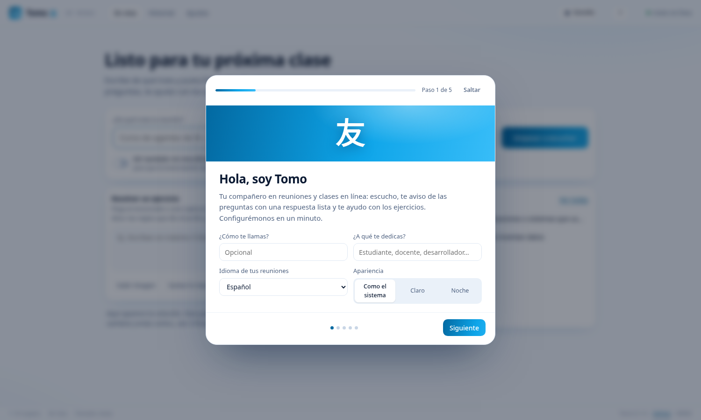

<div align="center">


# Tomo 友

**Tu copiloto de reuniones.** Escucha la clase, te sopla qué responder y resuelve los ejercicios contigo.
Un proyecto de **MIRAI** · 未来 · *el futuro, hoy*.

[Instalar](#instalar) · [Cómo funciona](#cómo-funciona) · [Modelos de IA](#modelos-de-ia) · [English](#english)

</div>



## Qué hace

- **Escucha la reunión** (Zoom, Teams, Webex) directo de la app, aunque tengas los audífonos con el volumen bajo. Para Meet en el navegador escucha la salida de audio. Whisper corre **en tu equipo**.
- **Detecta las preguntas** del expositor o de la diapositiva y te da una respuesta lista para decir o pegar en el chat (más corta u otra versión con un clic). No repite la misma pregunta aunque siga en pantalla.
- **Resuelve ejercicios**: pega el enunciado o una captura (`Ctrl`+`V`), marca en la transcripción las reglas que dio el profe y pulsa *Resolver*. Puedes pedir cambios sobre la misma solución.
- **Mira la pantalla correcta**: eliges el monitor de la reunión y ves en vivo lo que Tomo está mirando. Cada 20 s revisa si cambió la diapositiva.
- **Historial completo** de lo que se dijo: buscar, marcar frases y copiarlas.
- **Nota final en Markdown** (compatible con Obsidian): resumen, temas, herramientas mencionadas, ideas para tus proyectos y preguntas.
- **Nunca se queda sin ojos**: varias APIs en cadena y, si todas se quedan sin cupo, tu modelo local de Ollama.
- **Claro u oscuro** según tu sistema (o el que elijas), con los colores de MIRAI.
- **Asistente de bienvenida y recorrido guiado**: en el primer uso revisa tu equipo, te ayuda a elegir el modelo de IA y la pantalla; el botón «?» te muestra cada parte de la app.

| Modo noche | Modelos de IA | Novedades al actualizar |
|---|---|---|
|  |  |  |



## Instalar

```bash
curl -fsSL https://raw.githubusercontent.com/sJonathan15/tomo/main/install.sh | bash
```

Funciona en **Ubuntu/Debian, Fedora, Arch/CachyOS/Manjaro y openSUSE**, con **KDE, GNOME, Hyprland, Sway, niri o X11**. Requisito: **PipeWire** (viene por defecto en Ubuntu 22.10+, Fedora 34+ y Arch).

El instalador agrega lo que falte del sistema (pide tu contraseña solo para eso), crea su propio entorno de Python con Whisper, registra el servicio de usuario y el lanzador **Tomo** en tu menú. Si tienes tarjeta NVIDIA la usa; si no, Whisper corre en la CPU con un modelo más liviano.

```bash
tomo abrir          # abre la app
tomo empezar "Curso de IA — sesión 3"
tomo ayudame        # ¿qué digo ahora?
tomo estado | log | actualizar | desinstalar
```

**Recomendación:** Ubuntu 24.04 o Fedora con GNOME/KDE si estás eligiendo distro. Con una tarjeta NVIDIA de 4 GB o más todo va fluido; sin tarjeta también funciona, solo que la transcripción tarda un poco más.

## Modelos de IA

Whisper (el oído) siempre es local. Para **leer la pantalla, responder y resolver ejercicios** Tomo usa los modelos que elijas en **Ajustes › Modelos de IA**:

1. **APIs compatibles con OpenAI**, en el orden que quieras: Google Gemini (tiene plan gratis), NVIDIA NIM, OpenRouter, Groq, OpenAI u otra. Si una se queda sin cupo, Tomo pasa sola a la siguiente.
2. **Modelo local con Ollama**: Tomo detecta los modelos con visión que ya tienes y te recomienda uno según tu tarjeta de video (por ejemplo `qwen3-vl:2b-instruct`, 1,1 GB, que cabe junto a Whisper). Lo descargas con un botón.

**¿Prefieres que tu agente lo configure?** En Ajustes pulsa *Copiar prompt para tu agente* y pégalo en Claude Code, Codex o Gemini CLI: trae lo que Tomo detectó de tu equipo y los comandos exactos para agregar claves, probarlas y descargar el modelo local.

Las claves se guardan en `~/.config/tomo/modelos.json` con permisos `600` y la app nunca las muestra completas.

## Cómo funciona

```
Zoom/Teams ──► sink virtual «tomo_oido» ──► pw-record ──► Silero VAD (cortes en pausas reales) ──► Whisper ──► transcripción
                                                                                       │
pantalla (monitor elegido) ──► captura cada 20 s, solo si cambió ──► modelo con visión ─┤
                                                                                       ▼
                                                         preguntas · respuestas · ejercicios · nota final (Markdown)
```

- Motor: Python sin framework (`tomo/server.py`), servidor HTTP en `127.0.0.1:47870`, solo local.
- App: HTML + CSS + JS sin dependencias (`tomo/web/`), se recarga sola cuando se actualiza.
- Si el motor se reinicia en plena reunión, la retoma sin perder nada. Si la tarjeta de video se llena, Whisper pasa a la CPU; si se corta el audio, se relanza.
- Datos: `~/Documentos/Tomo` (una carpeta por reunión) y notas en `~/Documentos/Tomo/Notas` (o la carpeta que elijas, por ejemplo dentro de tu bóveda de Obsidian).

## Actualizaciones

Tomo revisa cada 6 horas si hay una versión nueva en GitHub. Cuando la hay, aparece **«Nueva versión»** arriba a la derecha: un clic muestra las mejoras y otro la instala (`git pull` + dependencias). Al volver, la app te enseña lo nuevo con una pequeña animación.

Para quien desarrolla: cada versión se anota en [`tomo/novedades.json`](tomo/novedades.json) y se sube `VERSION` en `tomo/server.py`.

## Privacidad

El audio nunca sale de tu equipo. A los modelos que configures solo se envía texto de la transcripción y, si lo activas, capturas de la pantalla de la reunión. Apaga *Mirar la pantalla* si vas a compartir algo privado.

## Licencia

MIT © 2026 Jonathan Cañar · MIRAI. Nombre, icono y diseño son originales de este proyecto.

---

## English

**Tomo (友, "companion")** is a meeting copilot for Linux by MIRAI. It listens to Zoom/Teams/Webex (or any audio output), transcribes locally with Whisper, detects questions and suggests what to answer, solves exercises from text or screenshots using what was said in class, and writes a Markdown note when the meeting ends.

- Install: `curl -fsSL https://raw.githubusercontent.com/sJonathan15/tomo/main/install.sh | bash` (Ubuntu/Debian, Fedora, Arch, openSUSE · KDE, GNOME, Hyprland, Sway, niri, X11 · PipeWire required).
- AI models: any OpenAI-compatible API (Gemini, NVIDIA NIM, OpenRouter, Groq, OpenAI…) chained in order, plus a local Ollama vision model as the last fallback. Tomo detects installed models and recommends one for your GPU.
- The UI is in Spanish for now; transcription and answers follow the meeting language (`Settings › Language`).

---

<div align="center">

**¿Te sirve Tomo?** Dale una ⭐ al repo: ayuda a que más personas lo encuentren.

Hecho con cariño en Ecuador por **MIRAI** · 未来

</div>
